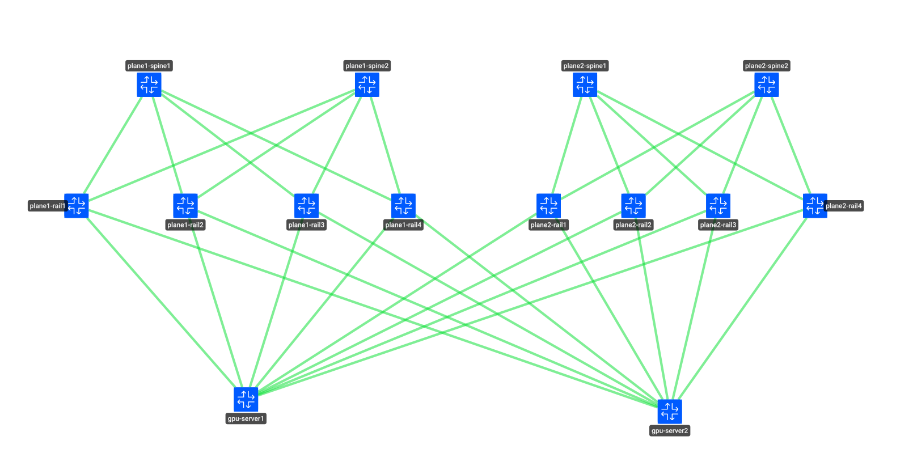
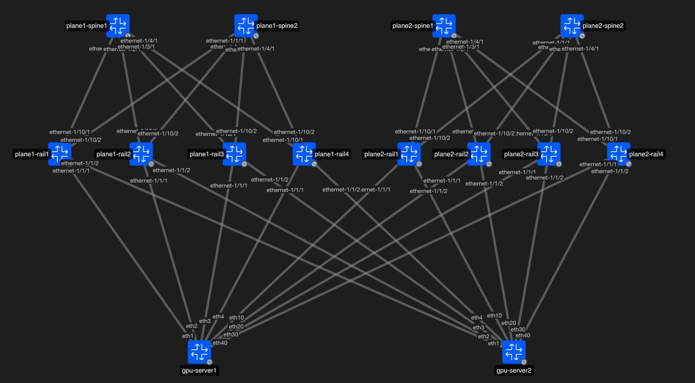

# Nokia Helios 2 Plane Network Fabric 

## Topology




## IP Mapping

| Plane | Rail | Switch Interface | Switch IPv6 / Gateway | GPU Server | GPU Interface | GPU IPv6 Address |
|---|---|---|---|---|---|---|
| plane1 | rail0 | ethernet-1/1/1 | fd00:2:13:1:2:1:0:1/96 | gpu-server1 | eth1 | fd00:2:13:1:2:1:0:2/96 |
| plane1 | rail0 | ethernet-1/1/2 | fd00:2:13:1:2:2:0:1/96 | gpu-server2 | eth1 | fd00:2:13:1:2:2:0:2/96 |
| plane1 | rail1 | ethernet-1/1/1 | fd00:2:13:1:2:3:0:1/96 | gpu-server1 | eth2 | fd00:2:13:1:2:3:0:2/96 |
| plane1 | rail1 | ethernet-1/1/2 | fd00:2:13:1:2:4:0:1/96 | gpu-server2 | eth2 | fd00:2:13:1:2:4:0:2/96 |
| plane1 | rail2 | ethernet-1/1/1 | fd00:2:13:1:2:5:0:1/96 | gpu-server1 | eth3 | fd00:2:13:1:2:5:0:2/96 |
| plane1 | rail2 | ethernet-1/1/2 | fd00:2:13:1:2:6:0:1/96 | gpu-server2 | eth3 | fd00:2:13:1:2:6:0:2/96 |
| plane1 | rail3 | ethernet-1/1/1 | fd00:2:13:1:2:7:0:1/96 | gpu-server1 | eth4 | fd00:2:13:1:2:7:0:2/96 |
| plane1 | rail3 | ethernet-1/1/2 | fd00:2:13:1:2:8:0:1/96 | gpu-server2 | eth4 | fd00:2:13:1:2:8:0:2/96 |
| plane2 | rail0 | ethernet-1/1/1 | fd00:2:13:2:2:1:0:1/96 | gpu-server1 | eth10 | fd00:2:13:2:2:1:0:2/96 |
| plane2 | rail0 | ethernet-1/1/2 | fd00:2:13:2:2:2:0:1/96 | gpu-server2 | eth10 | fd00:2:13:2:2:2:0:2/96 |
| plane2 | rail1 | ethernet-1/1/1 | fd00:2:13:2:2:3:0:1/96 | gpu-server1 | eth20 | fd00:2:13:2:2:3:0:2/96 |
| plane2 | rail1 | ethernet-1/1/2 | fd00:2:13:2:2:4:0:1/96 | gpu-server2 | eth20 | fd00:2:13:2:2:4:0:2/96 |
| plane2 | rail2 | ethernet-1/1/1 | fd00:2:13:2:2:5:0:1/96 | gpu-server1 | eth30 | fd00:2:13:2:2:5:0:2/96 |
| plane2 | rail2 | ethernet-1/1/2 | fd00:2:13:2:2:6:0:1/96 | gpu-server2 | eth30 | fd00:2:13:2:2:6:0:2/96 |
| plane2 | rail3 | ethernet-1/1/1 | fd00:2:13:2:2:7:0:1/96 | gpu-server1 | eth40 | fd00:2:13:2:2:7:0:2/96 |
| plane2 | rail3 | ethernet-1/1/2 | fd00:2:13:2:2:8:0:1/96 | gpu-server2 | eth40 | fd00:2:13:2:2:8:0:2/96 |

## Getting started

```
containerlab deploy -t helios.clab.yml
```


## Topology with interfaces



